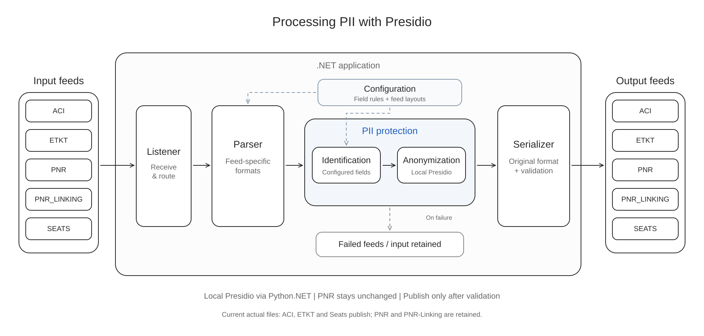

# Presidio Feed Protection Demo

Process airline feeds using configured field rules and local Presidio. PNR stays unchanged. Output is validated before publication; failed input is retained.



[Editable Excalidraw diagram](topics/feeds-demo/v14/presidio-feed-workflow-v3.excalidraw)

## Current feed status

| Feed | Actual input result |
| --- | --- |
| ACI | Published using the reviewed 888-byte reference layout |
| ETKT | Published using the reviewed 672-byte reference layout |
| Seats | Published using complete JSON |
| PNR | Retained; complete binary framing and layout need confirmation |
| PNR-Linking | Retained; supplied JSON ends inside a property name |

ACI and ETKT support the reviewed reference frames, rather than arbitrary producer messages. The external filename `TKT.txt` routes to ETKT. Protection uses irreversible masks or replacement labels; stable tokens are not implemented.

## Technology stack

| Technology | Version |
| --- | --- |
| C# / .NET | .NET 10 |
| Python.NET | 3.2.0 |
| CPython | 3.12.10 |
| Presidio Analyzer / Anonymizer | 2.2.364 |
| spaCy / en_core_web_lg | 3.8.16 / 3.8.0 |

Python runs inside the .NET process. Processing makes no HTTP calls or model downloads.

## Setup and run

Requires Windows, the .NET 10 SDK and Python 3.12. Run these steps in PowerShell from the project root.

### 1. Create the Python virtual environment

Do this once during initial setup:

```powershell
py -3.12 -m venv src/.venv
```

### 2. Activate the Python virtual environment

Activate it whenever you open a new PowerShell terminal:

```powershell
.\src\.venv\Scripts\Activate.ps1
```

If PowerShell reports that running scripts is disabled, allow locally created scripts for this terminal session, then retry activation:

```powershell
Set-ExecutionPolicy -Scope Process -ExecutionPolicy RemoteSigned
.\src\.venv\Scripts\Activate.ps1
```

If prompted, enter `Y`. The policy change lasts only until this PowerShell terminal closes; administrator access is not required. See [PowerShell execution policies](https://learn.microsoft.com/en-us/powershell/module/microsoft.powershell.core/about/about_execution_policies).

If your organization enforces a policy that still blocks activation, use the Python launcher to install packages for its selected interpreter:

```powershell
py -m pip install -r requirements.txt
```

With an active virtual environment and no explicit Python version, `py` uses that environment. Without activation, `py` uses its default interpreter and may install packages outside `src/.venv`. If activation remains blocked, confirm the selected interpreter with `py -c "import sys; print(sys.executable)"` before installing; it should end in `src\.venv\Scripts\python.exe` for this project.

The prompt normally shows `(.venv)` after activation. Confirm Python uses this environment:

```powershell
python -c "import sys; print(sys.executable)"
```

The path should end in `src\.venv\Scripts\python.exe`.

### 3. Install the Python packages

With the virtual environment active, install the required packages:

```powershell
python -m pip install -r requirements.txt
```

### 4. Deactivate the Python virtual environment

After package installation finishes, deactivate it:

```powershell
deactivate
```

### Build and run the .NET demo

```powershell
dotnet build
```

Process the actual feeds once, preserving the source files:

```powershell
dotnet run -- --process-folder D:/Bala_Support/Feeds
```

For continuous listening, run `dotnet run`, wait for `READY`, then copy a `.txt` MQ export or `.bin` payload into `docs/input-feeds/<feed>`. Press Enter or Ctrl+C to stop. Use the folders `ACI`, `ETKT`, `PNR`, `PNR-Linking` and `Seats`.

A batch succeeds only when every input is published and acknowledged. The supplied PNR and PNR-Linking files currently prevent a fully successful actual-file batch.

## Folders and configuration

- `src/`: C# worker, `feeds/`, `python/`, `config/` and `.venv/`.
- `tests/unit-tests/`: Python tests; `tests/FeedPipelineChecks/`: .NET checks.
- `docs/sample-docs/`: finalized reference TXT files.
- `docs/input-feeds/`, `output-feeds/`, `failed-feeds/`: one subfolder per feed.
- `docs/feed-logs/`: one text file per transaction, named `<feed>.<message-id>.txt`.
- `.runtime/docs/`: retained processing input, listener lock and batch reports.

Each transaction log has separate `BEFORE ANONYMIZATION` and `AFTER ANONYMIZATION` headings with divider lines. Successful transactions include parsed field values and complete input/output data; MQ exports also include the decoded payload. Binary data is shown as a hex dump with a readable character column. Rejected transactions retain the original data and explain why no validated anonymized output is available. Retries reuse the same log file. If a log cannot be saved, input remains pending and is retried before publication or rejection.

These logs contain original personal data and are excluded from Git. They are written under the selected `--docs-root` when a custom folder is used.

Edit [field policies](src/config/feed-policies.xml) to Keep, Mask, Replace or Redact fields. `Known` protects the entire value; `Analyze` uses local NLP. Reviewed binary profiles are in [reference layouts](src/config/reference-layouts.xml); general producer definitions belong in [XDR layouts](src/config/xdr-layouts.xml). Restart after configuration changes.

## Tests

```powershell
src/.venv/Scripts/python.exe -m unittest discover -s tests/unit-tests -p test_*.py -v
src/.venv/Scripts/python.exe tests/unit-tests/test_feed_listener.py
dotnet run --project tests/FeedPipelineChecks
```

[Implementation details](topics/feeds-demo/v14/feed-implementation-reference-v14.md) · [Feed format analysis](docs/feed-analysis.md)
