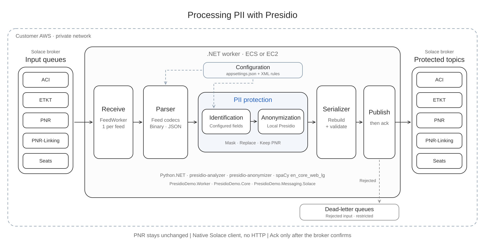

# Presidio Feed Protection Demo

Process airline feeds using configured field rules and local Presidio. PNR stays unchanged. Output is validated before publication; failed input is retained.

## Solution organization

The application remains one .NET project. Source folders and namespaces group files by responsibility:

```text
src/
├── Program.cs
├── Configuration/        Three XML configuration files
├── Feeds/
│   ├── ACI/              ACI binary processing
│   ├── ETKT/             ETKT binary processing
│   ├── PNRLinking/       PNR-Linking JSON route
│   ├── Seats/            Seats JSON route
│   └── Shared/           Contracts, formats and shared codecs
├── Pipeline/             Workflows, codec registry and batch processing
├── Protection/           Field policies and embedded Presidio bridge
│   └── python/           presidio_demo.py
└── Transport/            Folder listener, transport, runtime paths and logs
```

Namespaces follow these folders: `PresidioDemo.Feeds.Shared`, `PresidioDemo.Pipeline`, `PresidioDemo.Protection` and `PresidioDemo.Transport`. Existing per-feed namespaces remain under `PresidioDemo.Feeds`. The Python environment stays at `src/.venv`; its setup commands are unchanged. Default configuration paths now use `src/Configuration`, and embedded Python loads `src/Protection/python/presidio_demo.py`. Custom configuration switches remain available.



## Architecture diagrams

- [PII infrastructure on AWS](docs/diagrams/aws-pii-infrastructure.svg): proposed dev environment, with one exclusive queue and one listener per feed.
- [Feed protection workflow](docs/diagrams/presidio-feed-workflow.svg): how feeds move through the .NET listener, configured field identification and local Presidio, with validation before publication.

## C# conventions

Types and members include XML summaries. Parameters, return values and property values are documented where applicable, including positional record values and non-public helpers. The application build generates XML documentation.

Declarations use regions for fields and constants, constructors, methods, properties and indexers, and nested types. A file with only one top-level class does not need an outer `Classes` region; member regions inside that class still apply. Methods and properties are ordered by accessibility and then name; overloads stay together. Fields without runtime initializers are sorted by name, while initialized fields retain their construction order. Enum declarations retain their existing numeric and wire order. Control-flow and scoped resource statements use explicit blocks. Documentation does not add runtime annotation attributes.

The root [.editorconfig](.editorconfig) shares C# formatting preferences with Visual Studio. See [C# formatting and cleanup](docs/code-cleanup.md) for the cleanup profile, terminal commands and rules that still require review.

## Current feed status

| Feed | Actual input result |
| --- | --- |
| ACI | Dedicated module decodes the documented structures and rebuilds all six samples; reviewed XML controls protection-field coverage |
| ETKT | All six samples use one 136-slot definition; empty strings account for missing values |
| Seats | Feed-specific codec with shared System.Text.Json processing; 39 existing policy paths |
| PNR | Section structs and linked lists for repeating sections; 53 policy aliases; PNR.txt has 80 masked and 74 kept values |
| PNR-Linking | Feed-specific codec with shared System.Text.Json processing; 49 existing policy paths |

The three original XML formats remain: [reference mappings](src/Configuration/reference-layouts.xml), [feed policies](src/Configuration/feed-policies.xml), and [XDR structures](src/Configuration/xdr-layouts.xml). Each binary feed has one common structural definition. Optional extensions enable variable widths, optional groups, named capture mappings and 14 shared masking rules without replacing the original roots or feed sections. New structures use reviewed XML changes and a restart. Unsupported structures are retained without publication. `TKT.txt` routes to ETKT.

XDR raw-word blocks use `<words name="..." count="..." />`, a compact alias for the original fixed array of `uint32` values. The loader supports both forms and expands the alias before processing; byte widths, field paths and validation remain unchanged.

All 15 supplied samples pass actual local Presidio processing and independent byte checks: 19 identified PNR occurrences, source bytes and binary framing stay unchanged. The former ETKT `Text0132` mapping is corrected to two preserved raw words. See [verification results](docs/feed-analysis.md#reviewed-samples-and-results).

## ACI module and structure review

[src/Feeds/ACI](src/Feeds/ACI) contains separate XDR reader/writer, decoder, parser, encoder, serializer, models, structure definitions, indicators, report formatter and feed codec. The normal ACI route uses this module through `aciStructures="true"` on its schema-driven reference entry. Older custom configurations without this opt-in retain their existing codec. The decoder follows the supplied C-structure declaration order; the encoder rebuilds the complete payload. Existing XML remains the reviewed policy projection for the supplied sample family. Every populated string must have policy coverage, and unreviewed processing shapes are rejected.

The structure review corrects `seatNumber` to `departureGate`, `origin` to `terminatingCity`, and offset-based names to documented fields. Operational equipment, aircraft, gate, sector and process values are kept. Passenger names, actual passenger seat assignments, loyalty numbers and unresolved identifiers remain masked. PNR and numeric passenger IDs stay unchanged; the parser checks the `paxl_id` / `pax_id` association. This rewrite does not introduce tokenization.

An extra block after transaction times appears in all six samples but is not defined in the available structure declarations. It is explicitly named `unresolved_extension`, with observed layout and preserved masks. Its business meaning is unconfirmed. Some documented branches have no populated example; transcribing them does not establish a complete producer contract. Multiple-passenger decoding has a synthetic identity-link check; production processing still needs a reviewed XML projection for that shape.

Run focused ACI checks and produce decoded JSON with field locations:

```powershell
dotnet run --project tests/ACI/AciChecks.csproj -- .test-runs/aci-checks
```

Decoded analysis files intentionally contain original supplied values. The immutable workspace review, transcription, verification evidence are in `D:\Bala_Support\topics\aci\v2`.

## Dedicated ETKT module

`src/Feeds/ETKT` separates the XDR reader, writer, decoder, parser, encoder, serializer, models, structure definitions, readable report and route adapter. The normal ETKT route selects this module through `etktStructures="true"` on its schema-driven reference entry. Custom configurations without that setting retain their existing codec.

All six supplied messages begin with the observed framing words `5, 1, 0`. The screenshot enum declares only error=1, issue=2 and update=3. The implementation preserves the observed sample type 5 without assigning it an undocumented business meaning. Its body aligns with all 136 scalar slots in the screenshot history order. The encoder reconstructs the complete payload and original MQ envelope; XML remains the reviewed protection projection.

The legacy `pnr` field is displayed as **Agent terminal address — provisional mapping**, matching `h_aaa_lniata` in the screenshot. Its value and legacy alias remain unchanged. The screenshot maps legacy `Text0088` to the ticket-number field, `ticketNumber` to the global history sequence number, and the `Flight1`/`Flight2` blocks to new/previous flight details. These are provisional meanings for the observed type-5 family. The divide-event fields now use `newPnr` and `oldPnr` Keep rules, with provisional new/old PNR labels and serializer guards against changes. For example, ETKT_05 retains `FWGXKN` and `FWDZRF`; the other protected values keep their existing masks. No passenger identity or tokenization is inferred from these records.

Focused checks generate readable decoded JSON and exact scalar locations:

```powershell
dotnet run --project tests/ETKT/EtktChecks.csproj -- .test-runs/etkt-checks
```

Status reports include provisional, most-significant-bit-first labels alongside the original signed number and hexadecimal word. For example, `0x00002000` is Checked in (provisional), and `0x00004000` is Divided ETKT (provisional). Reserved set bits remain visible. The report shows exchange destination only when Exchanged is set; displaying labels never changes payload values or protection rules. Other indicator words remain raw.

The immutable ETKT review and evidence are under `D:\Bala_Support\topics\etkt\v4`. The searchable reference covers the documented input, history, coupon, payment, tax, exchange, fare, passenger and project structures, union arms and indicator comments. It records the repeated `etkt_inds_2` declaration in the issue branch as a source conflict. Populated issue/error branches and other unreviewed shapes still require producer evidence.

Checks cover exact binary and MQ-export round trips, agreement with an independent reader, malformed inputs, policy coverage, kept-field integrity and compatibility of the route setting. The comparison with prior protection rules allows differences only in the approved divide-event PNR spans; status labels introduce no payload changes.

## PNR-Linking and Seats JSON processing

`src/Feeds/PNRLinking/PnrLinkingFeedCodec.cs` and `src/Feeds/Seats/SeatsFeedCodec.cs` keep the per-feed folders and own each feed's route and root contract: PNR-Linking requires a JSON array, and Seats requires a JSON object. Both inherit the common `src/Feeds/Shared/JsonFeedCodec.cs`. JSON processing uses only `System.Text.Json`; no additional JSON package is required.

The shared implementation reads named JSON fields, resolves their existing wildcard XML policy paths, replaces selected string values and validates the rebuilt message. JSON supplies its own structure, so these feeds do not need separate structure definitions, domain models, decoders, encoders, parsers, serializers or report formatters. Four former JSON helper files are folded into the same shared class. Eighteen redundant source files were removed from the active project.

The implementation keeps the original UTF-8 JSON and scalar byte locations internally. It copies unchanged bytes and edits selected string values only, preserving property order, escapes, number spelling, nulls and empty containers. Serialization preserves the MQ envelope; validation checks PNRs, JSON types and every unselected payload byte, including empty-container structure. Parsed layouts cannot cross feed routes. Unknown populated paths still reject the whole message through policy resolution. Protection settings, replacement values and passenger grouping are unchanged.

Run the JSON checks and generate reports with the decoded payload and field paths:

```powershell
dotnet run --project tests/JsonFeeds
```

Reports include original supplied values and are saved under `.test-runs/json-feeds`. Immutable source snapshots, the removed-file inventory and verification evidence are in `D:\Bala_Support\topics\pnr-linking\v2` and `D:\Bala_Support\topics\seats\v2`. Earlier delivered folders retain the previous implementation.

## Technology stack

| Technology | Version |
| --- | --- |
| C# / .NET | .NET 10 |
| Python.NET | 3.2.0 |
| CPython | 3.12.10 |
| Presidio Analyzer / Anonymizer | 2.2.364 |
| spaCy / en_core_web_lg | 3.8.16 / 3.8.0 |

Python runs inside the .NET process. Processing makes no HTTP calls or model downloads.

## Setup and run

Requires Windows, the .NET 10 SDK and Python 3.12. Run these steps in PowerShell from the project root.

### 1. Create the Python virtual environment

Do this once during initial setup:

```powershell
py -3.12 -m venv src/.venv
```

### 2. Activate the Python virtual environment

Activate it whenever you open a new PowerShell terminal:

```powershell
.\src\.venv\Scripts\Activate.ps1
```

If PowerShell reports that running scripts is disabled, allow locally created scripts for this terminal session, then retry activation:

```powershell
Set-ExecutionPolicy -Scope Process -ExecutionPolicy RemoteSigned
.\src\.venv\Scripts\Activate.ps1
```

If prompted, enter `Y`. The policy change lasts only until this PowerShell terminal closes; administrator access is not required. See [PowerShell execution policies](https://learn.microsoft.com/en-us/powershell/module/microsoft.powershell.core/about/about_execution_policies).

If your organization enforces a policy that still blocks activation, use the Python launcher to install packages for its selected interpreter:

```powershell
py -m pip install -r requirements.txt
```

With an active virtual environment and no explicit Python version, `py` uses that environment. Without activation, `py` uses its default interpreter and may install packages outside `src/.venv`. If activation remains blocked, confirm the selected interpreter with `py -c "import sys; print(sys.executable)"` before installing; it should end in `src\.venv\Scripts\python.exe` for this project.

The prompt normally shows `(.venv)` after activation. Confirm Python uses this environment:

```powershell
python -c "import sys; print(sys.executable)"
```

The path should end in `src\.venv\Scripts\python.exe`.

### 3. Install the Python packages

With the virtual environment active, install the required packages:

```powershell
python -m pip install -r requirements.txt
```

### 4. Deactivate the Python virtual environment

After package installation finishes, deactivate it:

```powershell
deactivate
```

### Build and run the .NET demo

```powershell
dotnet build
```

Process the actual feeds once, preserving the source files:

```powershell
dotnet run -- --process-folder D:/Bala_Support/Feeds
```

For continuous listening, run `dotnet run`, wait for `READY`, then copy a `.txt` MQ export or `.bin` payload into `docs/input-feeds/<feed>`. Press Enter or Ctrl+C to stop. Use the folders `ACI`, `ETKT`, `PNR`, `PNR-Linking` and `Seats`.

A batch succeeds only when every input is published and acknowledged. Batch filenames accept numeric suffixes such as `ACI_03.txt` and `ETKT_05.txt`; the listener routes by feed folder and accepts arbitrary filenames. Samples are review/test inputs and are not required at runtime. The schemas describe the structures supported by the supplied examples; a producer contract is still needed to confirm unknown binary meanings and general passenger associations.

## Folders and configuration

- `src/`: startup, `Configuration/`, `Feeds/`, `Pipeline/`, `Protection/`, `Transport/` and `.venv/`.
- `tests/unit-tests/`: Python tests; `tests/FeedPipelineChecks/`: .NET checks.
- `docs/sample-docs/`: immutable source TXT files for review and testing; not required at runtime.
- `docs/input-feeds/`, `output-feeds/`, `failed-feeds/`: one subfolder per feed.
- `docs/feed-logs/`: one text file per transaction, named `<feed>.<message-id>.txt`.
- `docs/feed-processing/`: active input files, with one subfolder per feed.
- `.runtime/docs/`: listener lock and batch reports.

The listener moves each ready file from `docs/input-feeds/<feed>` into `docs/feed-processing/<feed>/<original-stem>.<unique-id>.<extension>`. This removes it from the input folder before processing starts. The same ID follows the transaction through its log and output. Once output is saved, the processing file is deleted. Rejected input is saved in `docs/failed-feeds/<feed>` with an error report before the processing file is deleted. Interrupted transactions and temporary storage failures stay in `feed-processing` for retry after restart. Older `.runtime/docs/processing` deliveries are migrated on startup while preserving their IDs and bytes.

Each transaction log has separate `BEFORE ANONYMIZATION` and `AFTER ANONYMIZATION` headings with divider lines. For MQ input, the before section shows the complete original feed data, decoded payload, a plain-text payload view, then parsed original fields (`location | policy field | value`). The plain-text view preserves readable UTF-8 text and whitespace; binary controls and invalid UTF-8 are shown as spaces. The after section shows the decoded anonymized payload followed by the complete rebuilt and validated feed data. Byte counts reflect the actual payload and feed sizes. Raw input or malformed MQ envelopes show complete input data and its plain-text view without a decoded payload. Binary data is shown as a hex dump with a readable character column. Rejected transactions retain the complete input data and any decoded payload and explain why no validated anonymized output is available. Retries reuse the same log file. If a log cannot be saved, input remains pending and is retried before publication or rejection.

These logs contain original personal data and are excluded from Git. They are written under the selected `--docs-root` when a custom folder is used.

All three XML files are loaded and validated together before input is claimed. Reference mappings retain `name`, `offset` and `length`; with `schemaDriven="true"`, these numbers document the reviewed baseline while the XDR structure determines actual input positions and widths. Reference sample filenames and hashes are provenance only in this mode. Original reference configurations without this flag retain their existing sample-based behavior. Binary fields use Keep or Known full-width ASCII masks. PNRs and confirmed operational fields stay unchanged. Unknown readable identifiers are masked, including the two additional ETKT codes. The three catalog rules for loyalty, sensitive attributes and financial information use `#` to preserve `*` record separators; other masks use `*`. JSON retains its original inline policies, replacement behavior, nulls, types and grouping.

Restart after changes. The existing switches `--reference-layout-file <xml>`, `--xdr-layout-file <xml>` and `--policy-file <xml>` select alternate files. See the [feed analysis](docs/feed-analysis.md) for commented XML examples, empty/optional values, per-sample results and verification commands.

## Tests

Run byte-exact round trips without anonymization for every feed type:

```powershell
dotnet run --project tests/FeedRoundTripChecks
```

These checks load the normal codecs and workflows, with an in-memory All-Keep policy for this test only. They compare complete input/output byte arrays, decoded payloads and field values over three cycles per example. Coverage includes all supplied samples as raw payloads and MQ exports, binary string widths and padding, JSON whitespace/property order/escapes/numeric spelling/empty/null values, MQ line endings, hex casing, row widths and complete diagnostic dumps. Synthetic variants test supported encoding shapes; they do not establish new producer contracts. No Python initialization or application configuration change is required. Results and execution logs are written to a fresh `.test-runs/round-trip-*` folder; supply a directory argument to choose another location. The same checks also run in `FeedPipelineChecks`.

```powershell
src/.venv/Scripts/python.exe -m unittest discover -s tests/unit-tests -p test_*.py -v
src/.venv/Scripts/python.exe tests/unit-tests/test_feed_listener.py
dotnet run --project tests/FeedPipelineChecks
src/.venv/Scripts/python.exe tests/run_sample_verification.py
```

[Implementation details](topics/feeds-demo/v14/feed-implementation-reference-v14.md) · [Feed format analysis](docs/feed-analysis.md)

## PNR sample mapping

The PNR route lives in `src/FeedCodecs/PNR`. The XDR schema follows the P2 PNR Record Layout sections (keys 01, 10, 20, 30, 40, 43, 50, 60, 80, C0, D0, D2, D8). Repeating sections are rpcgen linked lists: a `1` word precedes each element and a `0` word ends the list. The spec describes the MQ/RTA P2 record and excludes the real-time C-structure feed, so it supplies field meanings, not wire order; element shapes are fitted to PNR.txt and PNR_02.txt, and lists that are empty in both samples reject any content. Mixed record texts (SSR/OSI facts, frequent-flyer accounts, remarks and fare references) use ordered variants keyed by record code, such as DOCS, CTCE, CTCM and TKNE: the first matching pattern masks the personal values, the record syntax stays unchanged, and a catch-all masks unrecognized records whole. Neither the spec nor the samples carry a stable passenger ID. Run `dotnet run --project tests/PNR/PnrChecks.csproj -- <report-folder>` to write a decoded report for each PNR sample; reports contain original sample values.
